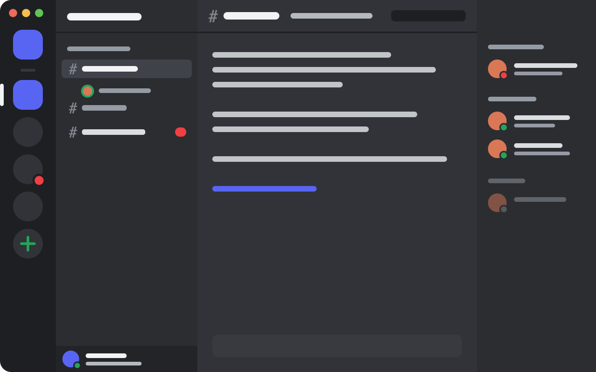

# Discord 풍 Herdr 레이아웃

[Herdr](https://herdr.dev) 창을 디스코드처럼 바꾸는 레이아웃입니다.

- 서버 목록 = 스페이스
- 채널 = 탭
- 채널 참가자·멤버 목록 = 에이전트
- 사용자 패널 = Claude 계정과 사용량

## 설치

Herdr 안에서 Claude 같은 에이전트에게 이렇게 말하면 됩니다.

> 이 Herdr 레이아웃 추가해 줘: <이 저장소 주소>

에이전트가 [RECIPE.md](RECIPE.md)를 읽고 파일을 옮긴 뒤 점검까지 합니다.

직접 설치하려면 다음 순서로 합니다.

1. `layouts/discord.json`·`layouts/discord.svg`를 `~/.config/herdr-app/layouts/`에, `mods/discord/`를 `~/.config/herdr-app/mods/`에 복사합니다.
2. `herdr-app check ~/.config/herdr-app/mods/discord`로 점검합니다.
3. 설정 화면에서 레이아웃 "discord"를 고르거나 `herdr-app do layout.switch '{"name":"discord"}'`를 실행합니다.

## 참고

- 글꼴 Pretendard(SIL OFL 1.1)가 들어 있습니다. 라이선스는 `mods/discord/fonts/OFL.txt`에 있습니다.
- 디스코드와 관계없는 팬메이드 레이아웃입니다. 디스코드 로고나 상표는 쓰지 않았습니다.
