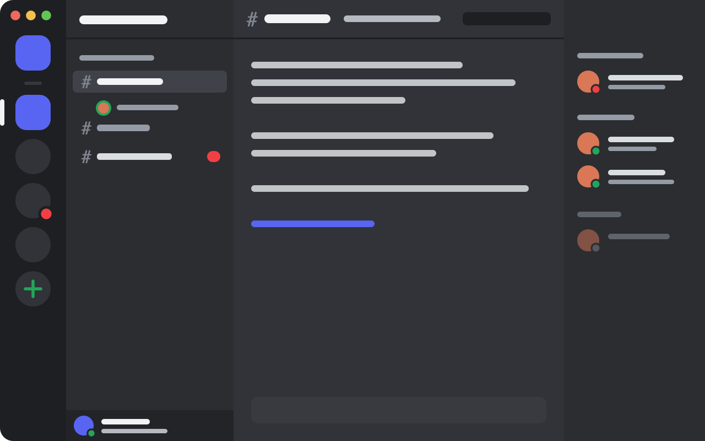

# Discord 풍

Herdr 창을 디스코드처럼 바꾸는 레이아웃이다.

- 왼쪽 서버 목록은 스페이스, 채널 목록은 탭이다.
- 채널 아래 음성 참가자 자리에 그 탭에서 도는 에이전트가, 오른쪽 멤버 목록에는 스페이스의 에이전트가 상태별로 나온다.
- 아래 사용자 패널은 지금 Claude 계정과 사용량이다.
- 색은 디스코드 다크 테마, 글꼴은 Pretendard 다.

## What you see

왼쪽에서 오른쪽으로 나열한다. 바탕색은 `#1e1f22` 이다.

**서버 목록** (72px, 바탕 `#1e1f22`)
- 맨 위 홈 버튼: 48px 원 안에 말풍선 아이콘.
- 그 아래 32×2 구분선(`#35373c`).
- 스페이스마다 48px 원.
  - 이름 단어의 첫 글자를 최대 세 글자까지 쓴다(`alpha-front` → `af`). 글자 크기는 한 글자 18, 두 글자 16, 세 글자 13.
  - 바탕은 `#313338` 이다. 스페이스 메뉴에서 색을 정해 두었으면(shared `space.colors`) 그 색을 쓴다.
- 맨 아래는 초록 `+` 원.
- macOS 에서는 창 버튼이 위쪽 38px 에 앉는다.

**채널 목록** (240px, 바탕 `#2b2d31`)
- 위 48px 머리줄: 스페이스 이름(15px semibold 흰색)과 ⌄.
- "⌄ 터미널 채널" 분류(12px semibold `#949ba4`), 오른쪽에 `+`.
- 탭마다 34px 채널 줄: `#` 아이콘(`#80848e`)과 탭 이름(15px medium).
- 채널 줄 아래로 그 탭의 에이전트가 30px 줄로 들여 써진다. 24px 아바타(프로그램 아이콘)와 이름이 나온다.

**사용자 패널** (채널 목록 아래 52px, 바탕 `#232428`)
- 32px 보라 원(계정 첫 글자)과 상태 점.
- 계정 이름(14px 흰색), 그 아래 `5h 18% · 주간 35%` (12px `#b5bac1`).
- 오른쪽에 리소스 모니터 아이콘과 톱니.

**채널 머리줄** (48px, 바탕 `#313338`)
- `#` 아이콘(24px), 탭 이름(16px semibold 흰색), 1px 세로선, 주제(14px `#b5bac1`).
- 주제는 키보드가 있는 창의 폴더(`~` 줄임)와 `⎇ 브랜치` 다.
- 오른쪽에 나누기, 파일 패널, 멤버 목록 아이콘과 "검색" 상자(144×24, 바탕 `#1e1f22`).

**터미널** (바탕 `#313338`)
- 창이 둘 이상이면 2px 틈(`#1e1f22`)으로 나뉜다. 키보드가 있는 창은 1px `#5865f2` 테두리다.

**멤버 목록** (240px, 바탕 `#2b2d31`)
- "입력 필요 — 1", "작업 중 — 2" 같은 묶음 제목(12px semibold `#949ba4`).
- 에이전트마다 44px 줄: 32px 아바타와 상태 점, 이름(15px medium), 아랫줄 "작업 중 · 9분째 · #1"(12px).

**색**
- 바탕 `#313338` / `#2b2d31` / `#232428` / `#1e1f22`
- 글자 `#dbdee1`, 흐린 글자 `#b5bac1` · `#949ba4`
- 강조 blurple `#5865f2`, 마우스 올림 `#35373c`, 고름 `#404249`
- 상태: 작업 중 `#23a55a`, 입력 필요 `#f23f43`, 완료 `#f0b232`, 대기 `#80848e`
- 터미널 ansi 16색도 디스코드 색(`#f23f43`, `#23a55a`, `#5865f2`, `#eb459e`, `#57f287`, `#fee75c` …)

## How it behaves

**에이전트 상태**

| 상태 | 서버 아이콘 | 채널 | 멤버 목록 |
|---|---|---|---|
| 입력 필요(blocked) | 빨간 숫자 뱃지(디스코드 멘션처럼 그 수) | 오른쪽에 빨간 숫자 | 빨간 점, 아랫줄 "입력을 기다려요"(빨강) |
| 작업 중(working) | 오른쪽 아래 깜빡이는 초록 점 | 깜빡이는 초록 점, 참가자 아바타에 초록 테두리(말하는 중) | 깜빡이는 초록 점, "작업 중 · N분째" |
| 완료(done, 안 봄) | 왼쪽 8px 흰 막대(안 읽음) | 흰 글씨와 왼쪽 흰 점 | 노란 점, "끝났어요 · 확인 전" |
| 대기(idle) | — | — | 회색 점, 줄 전체 50% 흐림(오프라인처럼) |

**서버 목록**
- 왼쪽 흰 막대: 고른 것 40px, 마우스 올림 20px. 높이가 160ms 동안 바뀐다.
- 고르거나 마우스를 올리면 원이 둥근 네모(반경 16)가 되고, 색이 없는 아이콘은 blurple 이 된다.
- 누르면 그 스페이스로 간다. 오른쪽 클릭은 스페이스 메뉴(기본 `menu` 모드)를 연다. 마우스를 올리면 이름이 툴팁으로 나온다.
- 홈을 누르면 채널 목록이 "다이렉트 메시지"로 바뀌고 멤버 목록은 모든 스페이스의 에이전트를 보여 준다(shared `discord.home`).
  - DM 줄은 아바타, 이름, "스페이스 · #탭" 이고 최근에 바뀐 순서다.
  - 위 "대화 찾기 또는 시작하기"는 `picker` 를 연다.
- `+` 를 누르면 `project-open` 모드가 있으면 연다(GitHub 주소로 clone 해 새 스페이스). 없으면 `space.new` 다.

**채널 목록**
- 누르면 `tab.select`, 두 번 누르면 `tab.rename`, 오른쪽 클릭은 탭 메뉴다.
- 분류의 `+` 는 기본 `new-menu`(터미널이나 에이전트 시작)를 연다.
- 머리줄을 누르면 스페이스 메뉴가 열린다.
- 참가자나 DM 줄을 누르면 `agent.focus` 한다.
- 치워 둔(settled) 탭은 숨긴다.

**머리줄 버튼**
- 나누기는 `pane.split right`, 파일 패널은 `layout.toggle panel`(⌘⇧E 와 같음), 멤버 목록은 `layout.toggle members` 다.
- 켜진 패널의 아이콘은 흰색이다.
- 검색 상자는 `picker` 를 연다.

**사용자 패널**
- 누르면 `claude-accounts` 모드 다이얼로그가 열린다.
- 상태 점은 5시간·주간 한도 중 큰 쪽에 따라 정해진다. 70% 넘으면 노랑, 90% 넘으면 빨강, 그 아래는 초록이다. 토큰 만료·로그인 필요는 빨강이다.

**그 밖에**
- 멤버 목록의 "N분째"는 1분마다 바뀐다.
- 멤버 목록 순서가 `agent.next`/`agent.prev` 순서다.
- 서버 목록과 채널 머리줄을 끌면 창이 움직인다(`window_drag`).

## Built from

**레이아웃** `layouts/discord.json`
- root `row`. 설정:
  - `theme: "graphite"` 위에 `colors` 39개로 모든 테마 색과 ansi0–15 를 덮는다(테마 파일 없이 들고 다니려고).
  - `ui_font: "Pretendard"`, `background: "canvas"`, `terminal_padding: [10, 16]`.
  - `titlebar: "none"`, `traffic_lights: [16, 14]`, `resizable: false`, `preview: "layouts/discord.svg"`.
- 트리:
  - `rail` 블록(72px, `window_drag`)
  - `sidebar` 열(240px): `channels` 블록 + `user` 블록(52px)
  - `work` 열: `header` 블록(48px, `window_drag`) + `work-body` 행
    - `main` = `{tab: "active"}`. pane 설정: gap 2, radius 0, border 1 `background`, focus 1 `accent`.
    - `members` 블록(240px, 최소 200, 최대 360)
    - `panel` 열(368px, 숨김): `files`·`changes` stack
- 모든 블록은 같은 모드 `discord` 를 쓰고 props `{view: "rail" | "channels" | "user" | "header" | "members"}` 로 나뉜다.

**모드** `mods/discord`
- `main.js` 가 `props().view` 로 그릴 파일을 고른다: `rail.js`, `channels.js`, `user.js`, `header.js`, `members.js`.
- `parts.js` 는 아이콘, 아바타, 상태 점, 멘션 뱃지다.
- `look.js` 는 순수 함수다. 머리글자, 제목 정리, 멤버 묶기, 채널 뱃지, 경과 시간, 사용량 문구.
- `herdr` 에서 쓰는 것:
  - `spaces()`, `agents()`, `panes()`, `focused()`, `layout()`, `window()`
  - `shared` / `setShared`, `run`, `openOverlay`, `setAgentOrder`, `exec`
- 부르는 명령:
  - `space.select`, `tab.select`, `tab.rename`, `agent.focus`
  - `pane.split`, `layout.toggle`, `mod.open`, `space.new`, `app.settings`
- 기본 모드: 메뉴는 `menu`, 새 탭은 `new-menu`, 검색은 `picker`.
- 프로그램 아바타는 `program.icon`/`tint`/`tile`/`color` 로 그린다.
- 아이콘은 lucide svg(`mods/discord/*.svg`)다.
- 글꼴 Pretendard Regular·Medium·SemiBold·Bold 가 `mods/discord/fonts/` 에 있다(SIL OFL 1.1, `OFL.txt`).

**함께 쓰면 좋은 모드**(없어도 된다. 없으면 그 버튼을 감추거나 기본 동작으로 바뀐다)
- `project-open`: `+`
- `claude-accounts` 와 `~/.local/bin/claude-acct`: 사용자 패널의 계정·사용량. 모드가 shared `claude-accounts.usage`·`claude-accounts.rev` 를 쓴다.
- `resource-monitor`: 사용자 패널 아이콘

## Watch out

**실행하는 것과 읽는 것**
- 네트워크에 나가지 않는다.
- `~/.local/bin/claude-acct` 가 있을 때만 `claude-acct list --json` 을 실행한다(지금 계정 이름과 요금제). 계정이 바뀌면(shared `claude-accounts.rev`) 다시 읽고, 3초마다 바뀌었는지만 본다.
- 읽는 파일은 `~/.config/herdr-app/mods/` 아래 위 세 모드가 있는지뿐이다.

**만들 때 걸리는 것**
- props 는 `init(props, cx)` 의 첫 인자로 오지 않는다. `props()` 로 읽어야 한다. 인자로 읽으면 모든 칸에 점검용 화면(다섯 부분이 나란히)이 그려진다.
- `herdr-app check` 는 props 를 못 넘긴다. 그래서 `checking()` 일 때 모든 부분을 홈(DM) 화면까지 나란히 그린다.

**설치·이름**
- 모드 이름이 `discord` 가 아니면 `parts.js` 의 `mods/discord/` 아이콘 경로를 같이 바꾼다.

**색·글꼴**
- 색이 레이아웃 `colors` 에 있어서 테마 메뉴로 다른 테마를 골라도 이 레이아웃 색은 안 바뀐다.
- 글꼴은 Herdr 를 시작할 때나 다음 모양 변경 때 읽힌다. 설치 직후 다른 글꼴로 보이면 Herdr 를 다시 켠다.

**시험하지 못한 것**
- 창 버튼 자리(`traffic_lights`)는 1x 모니터 macOS 에서만 맞췄다.

## Done when

- `herdr-app check mods/discord` 가 통과하고, `node --test mods/discord/tests/*.test.mjs` 의 10개가 통과한다.
- `layout.switch {name: "discord"}` 뒤 왼쪽에 스페이스마다 머리글자 원이 나오고, 지금 스페이스 옆에 40px 흰 막대가 있다.
- 채널 목록에 지금 스페이스의 탭이 `# 이름` 으로 나오고, 그 아래 에이전트가 나온다.
- Claude 에게 일을 시키면 그 채널과 서버 아이콘에 깜빡이는 초록 점이 생긴다. 멤버 목록에는 "작업 중 — 1"과 "작업 중 · 방금 시작"이 뜬다.
- 권한을 물으면 서버 아이콘과 채널에 빨간 `1` 이 뜬다.
- 홈 버튼을 누르면 "다이렉트 메시지" 목록에 모든 에이전트가 나온다. 줄을 누르면 그 에이전트로 간다.
- 머리줄의 사람 아이콘을 누르면 멤버 목록이 숨었다 다시 나온다.
